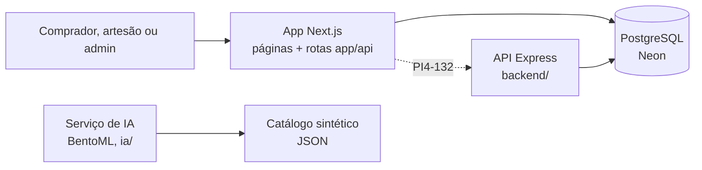

# Raízes PE - Marketplace da Economia Criativa


Marketplace que conecta artesãos de Pernambuco diretamente a compradores. O artesão cadastra suas peças e acompanha as vendas; o comprador encontra produtos por técnica e região, recebe recomendações e compra pelo site ou pelo WhatsApp.

O projeto foi pensado para quem tem pouca familiaridade com compras online: telas simples, uma instrução por vez e botões com texto, não só ícones.

**Acesse:** <https://raizes-pe-gules.vercel.app> (use os [logins de demonstração](#logins-de-demonstração))

Projeto Integrador do 4º período de Análise e Desenvolvimento de Sistemas, CESAR School.

## Funcionalidades

**Comprador**
- Vitrine com busca e filtros por técnica, região e categoria.
- Página do produto e do artesão, carrinho e checkout passo a passo.
- Compra via WhatsApp, com link direto para o artesão.
- Recomendações explicadas ("Inspirado no seu apreço por Cerâmica"), com peças populares para quem ainda não comprou.
- Acompanhamento dos pedidos em `/meus-pedidos` (pendente, pago, enviado, entregue).

**Artesão** (`/painel`)
- Resumo da loja: vendas, pedidos pendentes e visualizações.
- Gráficos de faturamento e de vendas por técnica.
- Cadastro e edição de produtos, com controle de estoque.
- Gestão dos pedidos recebidos ("marcar como enviado" avisa o comprador).

**Administrador** (`/admin`)
- Visão geral da plataforma: vendas, artesãos, produtos e pedidos.
- Gestão de artesãos, moderação de produtos e categorias.

## Tecnologias

| Parte | Stack |
|---|---|
| Front | Next.js (App Router), TypeScript, Chakra UI, Recharts |
| API | Express 5 + TypeScript em camadas, OpenAPI/Swagger, Prisma 7 |
| Banco | PostgreSQL no Neon |
| IA | Motor de recomendação em TypeScript no app e serviço em BentoML (Python) |

## Como funciona



- Hoje o site roda inteiro no **app Next.js**: as páginas e as rotas `app/api/*` leem e gravam direto no banco.
- A **API Express** já tem as mesmas rotas, organizadas em camadas e documentadas no Swagger. O front passa a usá-la na PI4-132 (linha tracejada).
- O **serviço de IA** da AV2 roda separado, com dados sintéticos, e mostra o módulo de recomendação especificado na AV1.

## Inteligência artificial

São dois motores de recomendação:

- **No app** ([`lib/motorRecomendacao.ts`](lib/motorRecomendacao.ts)): recomenda pelo histórico de compras (técnica e região preferidas), ignora peças sem estoque e explica cada sugestão. Para visitantes sem histórico, mostra peças populares e bem avaliadas. Regras em [`docs/BASELINE_IA.md`](docs/BASELINE_IA.md).
- **Serviço da AV2** ([`ia/`](ia/README.md)): recomenda a partir de um produto ou de um filtro de técnica e região, com popularidade, cold start e 30% da lista reservada para diversificação. Tem contrato, testes de copiar e colar e métricas do baseline.

## Qualidade

- Testes automatizados com `node:test` no front (`tests/`) e na API (`backend/test/`): regras de recomendação, sessão, máscaras, rotas e permissões.
- Um teste da API falha se alguma rota não estiver documentada no `backend/openapi.yaml`.
- Lint (ESLint) e typecheck (TypeScript) nos dois projetos. Os comandos estão no [guia de desenvolvimento](docs/desenvolvimento.md#scripts-úteis).

## Como rodar

Pré-requisitos: [Node.js](https://nodejs.org/en/) 22 LTS e a connection string do banco no Neon (peça ao responsável pelo banco, por um canal privado).

```bash
git clone https://github.com/brunosm26/Raizes-PE.git
cd Raizes-PE
npm install
cp .env.example .env.local      # no Windows (cmd): copy .env.example .env.local
```

No `.env.local`, preencha a `DATABASE_URL` (connection string **pooled** do Neon) e o `SESSION_SECRET` (gere com `node -e "console.log(require('crypto').randomBytes(32).toString('hex'))"`). Depois:

```bash
npm run dev
```

Acesse <http://localhost:3000>. Para conferir a conexão com o banco, abra <http://localhost:3000/api/saude-bd>.

Para subir também a API Express, configurar o banco do zero ou ver os scripts de teste, siga o [guia de desenvolvimento](docs/desenvolvimento.md).

## Logins de demonstração

| Perfil | E-mail | Senha |
|---|---|---|
| Comprador | `ana.beatriz@raizespe.dev` | `demo123` |
| Artesão | `tacaratu@raizespe.dev` | `demo123` |
| Admin | `admin@raizespe.dev` | `demo123` |

A tela `/cadastro` cria uma conta de comprador nova.

## Estado atual

- Catálogo, pedidos, produtos do painel, login e recomendações já usam o banco.
- O admin ainda usa dados de exemplo (`lib/dadosFalsos.ts`), e a aprovação de artesãos, a moderação e as categorias ficam só no navegador.
- A API Express já tem as mesmas rotas do app, mas o front ainda não a chama (PI4-132).

**Próximos passos:** alerta de baixo estoque, moderação e categorias do admin no banco, criação de contas de artesão pelo admin e recomendação colaborativa. O plano está em [`docs/plano-migracao-api.md`](docs/plano-migracao-api.md).

## Documentação

| Documento | Conteúdo |
|---|---|
| [`docs/desenvolvimento.md`](docs/desenvolvimento.md) | Front e API juntos, variáveis de ambiente, banco, scripts, problemas comuns e estrutura de pastas |
| [`backend/README.md`](backend/README.md) | API Express: instalação, Prisma, Swagger e testes |
| [`ia/README.md`](ia/README.md) | Módulo de IA da AV2: serviço BentoML, contrato e testes |
| [`docs/arquitetura-backend.md`](docs/arquitetura-backend.md) | Camadas do backend e mapa da migração |
| [`docs/estrategia-autenticacao.md`](docs/estrategia-autenticacao.md) | Sessão, senha e perfis de acesso |
| [`docs/BASELINE_IA.md`](docs/BASELINE_IA.md) | Regras do motor de recomendação do app |
| [`docs/CONTRATO_API.md`](docs/CONTRATO_API.md) | Contrato inicial da API |
| [`docs/RELATORIO_TESTES_W12.md`](docs/RELATORIO_TESTES_W12.md) | Relatório de testes e rastreabilidade |

## Autoria

- Bruno José Cavalcanti Duarte Filho
- Bruno Sottomayor Martin
- Caio Gilles Costa Medeiros de Souza
- Gustavo Rafael Renaux Veloso
- Igor Kauã de Souza Siqueira
- Matheus Conolly
- Leonardo Felipe Demétrio
- Hilton Resende Montes Neto
- Maria Clara Miranda Ferraz
- Ramon Taffarel Guimarães
- Pedro Henrique Cavalcanti e Silva
