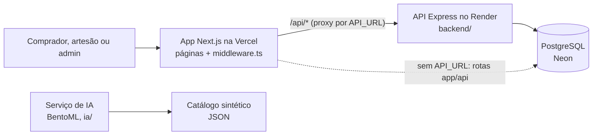

# Raízes PE - Marketplace da Economia Criativa


Marketplace que conecta artesãos de Pernambuco diretamente a compradores. O artesão cadastra suas peças e acompanha as vendas; o comprador encontra produtos por técnica e região, recebe recomendações e faz o pedido pelo site, e o artesão combina pagamento e entrega pelo WhatsApp.

O projeto foi pensado para quem tem pouca familiaridade com compras online: telas simples, uma instrução por vez e botões com texto, não só ícones.

**Acesse:** <https://raizes-pe-gules.vercel.app> (use os [logins de demonstração](#logins-de-demonstração)). A API fica em <https://raizes-pe-api.onrender.com>, com o Swagger em `/api-docs`. No plano gratuito do Render, a primeira chamada depois de um tempo parado demora alguns segundos.

Projeto Integrador do 4º período de Análise e Desenvolvimento de Sistemas, CESAR School.

## Funcionalidades

**Comprador**
- Vitrine com busca e filtros por técnica, região e categoria.
- Página do produto e do artesão, carrinho e checkout passo a passo.
- Checkout simulado: nada é cobrado; o comprador informa um telefone com WhatsApp e o artesão entra em contato para combinar pagamento e entrega.
- Recomendações explicadas ("Inspirado no seu apreço por Cerâmica"), com peças populares para quem ainda não comprou.
- Acompanhamento dos pedidos em `/meus-pedidos` (pendente, pago, enviado, entregue).

**Artesão** (`/painel`)
- Resumo da loja: vendas do mês, pedidos pendentes e peças em estoque.
- Gráficos de faturamento e de vendas por técnica.
- Cadastro e edição de produtos, com controle de estoque.
- Gestão dos pedidos recebidos ("marcar como enviado" avisa o comprador).

**Administrador** (`/admin`)
- Visão geral da plataforma: vendas, artesãos, produtos e pedidos.
- Gestão de artesãos (quem já tem login), moderação de produtos e categorias tiradas dos produtos.

## Tecnologias

| Parte | Stack |
|---|---|
| Front | Next.js (App Router), TypeScript, Chakra UI, Recharts |
| API | Express 5 + TypeScript em camadas, OpenAPI/Swagger, Prisma 7 |
| Banco | PostgreSQL no Neon |
| IA | Motor de recomendação em TypeScript no app e serviço em BentoML (Python) |

## Como funciona



- O **app Next.js** serve as páginas e protege as áreas logadas no `middleware.ts`. Todas as telas leem e gravam pela API (`/api/...`).
- Com a `API_URL` definida, o Next repassa todo `/api/*` para a **API Express** (`backend/`, em camadas e documentada no Swagger). É assim que o site publicado funciona. O navegador só fala com o domínio do site, então o cookie de sessão continua first-party e não precisa de CORS.
- Sem a `API_URL`, respondem as rotas `app/api/*` do próprio Next, com o mesmo contrato (linha tracejada). Elas ficam como alternativa para rodar só o front.
- O **serviço de IA** da AV2 roda separado, com dados sintéticos, e mostra o módulo de recomendação especificado na AV1.

## Inteligência artificial

São dois motores de recomendação:

- **No app** ([`lib/motorRecomendacao.ts`](lib/motorRecomendacao.ts)): recomenda pelo histórico de compras (técnica e região preferidas), ignora peças sem estoque e explica cada sugestão. Para visitantes sem histórico, mostra peças populares e bem avaliadas. Regras em [`docs/BASELINE_IA.md`](docs/BASELINE_IA.md).
- **Serviço da AV2** ([`ia/`](ia/README.md)): recomenda a partir de um produto ou de um filtro de técnica e região, com popularidade, cold start e 30% da lista reservada para diversificação. Tem contrato, testes de copiar e colar e métricas do baseline.

## Qualidade

- Testes automatizados com `node:test` no front (`tests/`) e na API (`backend/test/`): regras de recomendação, sessão, máscaras, rotas e permissões.
- Um teste da API falha se alguma rota não estiver documentada no `backend/openapi.yaml`.
- Lint (ESLint) e typecheck (TypeScript) nos dois projetos. Os comandos estão no [guia de desenvolvimento](docs/desenvolvimento.md#scripts-úteis).

## Como rodar

Sobe o front (Next, porta 3000) e a API (Express, porta 4000) juntos, como no site publicado. A tabela completa de variáveis, os testes e os problemas comuns estão no [guia de desenvolvimento](docs/desenvolvimento.md).

**Pré-requisitos:** [Node.js](https://nodejs.org/en/) 20.19+ ou 22.12+ (o Prisma 7 do backend exige) e um banco PostgreSQL. Use o Neon do time, pedindo a connection string **pooled** ao responsável pelo banco por um canal privado, ou um Postgres local descartável em [Docker](https://www.docker.com/) (passo 2).

**1. Instalar** (a raiz e o `backend/` têm cada um o seu `package.json`):

```bash
git clone https://github.com/brunosm26/Raizes-PE.git
cd Raizes-PE
npm install
cd backend && npm install && cd ..
```

**2. Banco.** Com o Neon do time, pule para o passo 3. Para um banco local com a carga de demonstração, siga ["Banco local em Docker"](docs/desenvolvimento.md#banco-local-em-docker) no guia: um container PostgreSQL com os scripts `db/01`, `04`, `05`, `06` e `07`.

**3. Variáveis.** Copie os dois modelos (nenhum dos arquivos copiados vai para o GitHub):

```bash
cp .env.example .env.local           # Windows (cmd): copy .env.example .env.local
cp backend/.env.example backend/.env # Windows (cmd): copy backend\.env.example backend\.env
```

- `backend/.env`: `DATABASE_URL` (a do Neon ou a do banco local) e `SESSION_SECRET`.
- `.env.local`: o **mesmo** `SESSION_SECRET`. A `API_URL=http://localhost:4000` já vem preenchida.
- Para gerar o `SESSION_SECRET`: `node -e "console.log(require('crypto').randomBytes(32).toString('hex'))"`.

**4. Subir**, em dois terminais:

```bash
# terminal 1: API
cd backend
npm run dev

# terminal 2: front (na raiz)
npm run dev
```

**5. Conferir:**
- <http://localhost:4000/api/saude> e <http://localhost:3000/api/saude> devem responder `{"ok":true}`. Essa rota só existe no Express, então a resposta pela porta 3000 prova que o Next está repassando `/api/*` para a API.
- <http://localhost:3000/api/saude-bd> confirma o banco.
- Abra <http://localhost:3000> e entre com um dos logins abaixo. O Swagger da API fica em <http://localhost:4000/api-docs>.

Para rodar só o front, sem a API: no `.env.local`, apague a `API_URL` e preencha a `DATABASE_URL`. As rotas `app/api` do Next respondem com o mesmo contrato.

## Logins de demonstração

| Perfil | E-mail | Senha |
|---|---|---|
| Comprador | `ana.beatriz@raizespe.dev` | `demo123` |
| Artesão | `tacaratu@raizespe.dev` | `demo123` |
| Admin | `admin@raizespe.dev` | `demo123` |

A tela `/cadastro` cria uma conta de comprador nova.

Os outros artesãos do catálogo só entram depois que o responsável pelo banco grava a senha deles com `npm run contas:artesao`. Essa senha não fica no repositório: é passada a cada pessoa em particular ([`docs/estrategia-autenticacao.md`](docs/estrategia-autenticacao.md), seção 13).

## Estado atual

- **Todas as telas leem e gravam pela API**, com os dados no PostgreSQL: vitrine e filtros, produto, perfil do artesão, carrinho e checkout, pedidos, painel do artesão, login e cadastro, recomendações e as telas do admin. Os dados de exemplo do front foram removidos na PI4-144.
- **API Express publicada** no Render, e o front da Vercel a usa pelo proxy da `API_URL` (PI4-132 e PI4-134). As rotas `app/api` do Next continuam como alternativa para rodar só o front.
- **Admin (PI4-143):** a gestão de artesãos usa `GET /api/artesaos` (só admin) e mostra quem já tem login. `/admin/categorias` é só leitura, com as categorias tiradas dos produtos (`GET /api/filtros`, a mesma rota dos filtros da vitrine). Os artesãos da carga sem senha ganham uma pelo `npm run contas:artesao`, rodado pelo responsável pelo banco.
- **Continua de demonstração:** a aprovação de artesãos (pendente é quem ainda não tem login) e a moderação de produtos (em revisão é o produto sem foto ou cadastrado nos últimos 7 dias) ficam só no navegador (`localStorage`), sem gravar no banco.
- **Banco:** a estrutura é definida pelas migrations do Prisma (`backend/prisma/migrations`, PI4-147), e o `db/ddl_final.sql` é gerado a partir delas.

**Próximos passos:** alerta de baixo estoque e recomendação colaborativa. Do lado do banco, o responsável ainda marca a baseline das migrations no Neon e roda o `contas:artesao` (veja [`docs/publicacao.md`](docs/publicacao.md)). **Backlog:** tabela de categorias, colunas de aprovação de artesãos e de moderação de produtos no banco, tela de criação de artesão no admin, troca de senha pelo próprio usuário e remoção das rotas `app/api` do Next quando o Express for o único caminho. O histórico da migração está em [`docs/plano-migracao-api.md`](docs/plano-migracao-api.md).

## Documentação

| Documento | Conteúdo |
|---|---|
| [`docs/desenvolvimento.md`](docs/desenvolvimento.md) | Front e API juntos, variáveis de ambiente, banco local, testes, scripts, problemas comuns e estrutura de pastas |
| [`backend/README.md`](backend/README.md) | API Express: instalação, Prisma, migrations, Swagger e testes |
| [`docs/publicacao.md`](docs/publicacao.md) | Site na Vercel, API no Render, roteiro de testes no ambiente publicado e pendências do responsável pelo banco |
| [`ia/README.md`](ia/README.md) | Módulo de IA da AV2: serviço BentoML, contrato e testes |
| [`docs/MODULO_IA.md`](docs/MODULO_IA.md) | Documento final do módulo de IA: objetivo, dados, regras, métricas e integração |
| [`docs/arquitetura-backend.md`](docs/arquitetura-backend.md) | Camadas do backend e ligação do front ao Express |
| [`docs/plano-migracao-api.md`](docs/plano-migracao-api.md) | Histórico da migração dos dados de exemplo para a API real |
| [`docs/estrategia-autenticacao.md`](docs/estrategia-autenticacao.md) | Sessão, senha, perfis de acesso e senha das contas de artesão |
| [`docs/dicionario-de-dados.md`](docs/dicionario-de-dados.md) | Dicionário de dados do schema `origem`: tabelas, colunas, chaves, restrições, domínios e view de popularidade |
| [`docs/der-e-modelo-logico.md`](docs/der-e-modelo-logico.md) | DER e modelo lógico do schema final, com diagramas em `docs/diagramas/` |
| [`docs/BASELINE_IA.md`](docs/BASELINE_IA.md) | Regras do motor de recomendação do app |
| [`docs/CONTRATO_API.md`](docs/CONTRATO_API.md) | Contrato inicial da API (o contrato real está em `backend/openapi.yaml`) |
| [`docs/RELATORIO_TESTES_W12.md`](docs/RELATORIO_TESTES_W12.md) | Relatório de testes e rastreabilidade |
| [`docs/regressao-w14.md`](docs/regressao-w14.md) | Regressão pós-migração na versão publicada |
| [`docs/analise-code-smell-pedro.md`](docs/analise-code-smell-pedro.md) | Análise de code smell (Magic Numbers) e refatoração do ranking de recomendações |

## Autoria

- Bruno José Cavalcanti Duarte Filho
- Bruno Sottomayor Martin
- Caio Gilles Costa Medeiros de Souza
- Gustavo Rafael Renaux Veloso
- Igor Kauã de Souza Siqueira
- Matheus Conolly
- Leonardo Felipe Demétrio
- Hilton Resende Montes Neto
- Maria Clara Miranda Ferraz
- Ramon Taffarel Guimarães
- Pedro Henrique Cavalcanti e Silva
