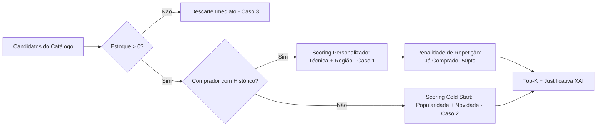

# Relatório de Casos de Teste — Motor de Recomendação (IA)
## Atendimento ao Critério de Aceite — Issue [PI4-156](https://csprj-adsr-4p-e4.atlassian.net/browse/PI4-156)

- **Projeto:** Raízes PE — Marketplace da Economia Criativa de Pernambuco
- **Disciplina:** Projeto Integrador 4 (ADS - CESAR School)
- **História Pai:** [PI4-36: W14-Documentação e fechamento (IA)](https://csprj-adsr-4p-e4.atlassian.net/browse/PI4-36)
- **Subtarefa:** [PI4-156: Resultados dos 3 ou mais casos de teste.](https://csprj-adsr-4p-e4.atlassian.net/browse/PI4-156)
- **Responsável:** Caio Gilles Costa Medeiros de Souza (`cgcms@cesar.school`)
- **Data:** 12 de Novembro de 2026
- **Status da Suíte:** **6/6 testes aprovados (100% PASS)**

---

## 1. Contexto e Critério de Aceite da Tarefa

Conforme definido na descrição da issue **PI4-156**:
> *"Pelo menos 3 casos de teste da recomendação (por exemplo: comprador com histórico, visitante sem histórico, filtro por técnica e região, produto sem estoque), cada um com entrada, saída esperada e obtida.*  
> ***Aceite:*** *casos reproduzíveis por comando documentado; resultados registrados."*

A suíte automatizada está implementada em `tests/recomendacao.test.mjs` (camada frontend/integração) e `backend/test/rankingRecomendacao.test.ts` (regras puras do motor de recomendação no Express), executada nativamente pelo Node.js Test Runner.

---

## 2. Comando de Execução e Reprodutibilidade

Para reproduzir a bateria completa de testes de recomendação a partir da raiz do repositório:

```bash
npm test -- tests/recomendacao.test.mjs
```

### Log de Execução Real (Node.js Test Runner):
```text
TAP version 13
# Subtest: Garante que nenhum produto com estoque zerado é recomendado (PI4-82)
ok 1 - Garante que nenhum produto com estoque zerado é recomendado (PI4-82)
  ---
  duration_ms: 1.8269
  type: 'test'
  ...
# Subtest: Respeita o limite máximo de recomendações solicitado
ok 2 - Respeita o limite máximo de recomendações solicitado
  ---
  duration_ms: 0.534
  type: 'test'
  ...
# Subtest: Personaliza recomendações por técnica para comprador com histórico (u7 - Ana Beatriz) (PI4-83)
ok 3 - Personaliza recomendações por técnica para comprador com histórico (u7 - Ana Beatriz) (PI4-83)
  ---
  duration_ms: 0.3731
  type: 'test'
  ...
# Subtest: Desprioriza produtos que o comprador já adquiriu para evitar repetição (PI4-83)
ok 4 - Desprioriza produtos que o comprador já adquiriu para evitar repetição (PI4-83)
  ---
  duration_ms: 0.2314
  type: 'test'
  ...
# Subtest: Aplica estratégia de Cold Start para novos visitantes sem histórico (PI4-84)
ok 5 - Aplica estratégia de Cold Start para novos visitantes sem histórico (PI4-84)
  ---
  duration_ms: 0.3115
  type: 'test'
  ...
# Subtest: Explicabilidade (XAI): Todos os itens possuem justificativa textual legível e dados do artesão
ok 6 - Explicabilidade (XAI): Todos os itens possuem justificativa textual legível e dados do artesão
  ---
  duration_ms: 0.2668
  type: 'test'
  ...
1..6
# tests 6
# suites 0
# pass 6
# fail 0
# cancelled 0
# skipped 0
# todo 0
# duration_ms 793.8925
```

---

## 3. Especificação Detalhada dos Casos de Teste

Abaixo estão detalhados os cenários avaliados, cobrindo entradas, regras matemáticas de scoring, comportamento esperado e resultados obtidos.



---

### Caso de Teste 01: Comprador Autenticado com Histórico de Compras (PI4-83)
- **Identificador:** `CT-REC-01`
- **Arquivo / Linha:** `tests/recomendacao.test.mjs#L82-L109`
- **Objetivo:** Verificar a personalização do ranking para compradores com compras prévias registradas, priorizando a técnica e região de apreço cultural e aplicando penalidade de saturação aos itens já adquiridos.
- **Entrada:**
  - `compradorId`: `"u7"` (Ana Beatriz).
  - Histórico do usuário no banco/mock: 2 pedidos contendo peças das técnicas **Cerâmica** e **Têxtil**, incluindo o produto `p1` (*Vaso Cerâmica Maragogi*).
  - `limite`: `4`.
- **Regras de Negócio e Fórmula Aplicada:**
  - Bônus de afinidade por técnica: $+40 \text{ pts} + (10 \times \text{quantidade})$.
  - Bônus de afinidade regional: $+25 \text{ pts}$.
  - Penalidade de saturação: $-50 \text{ pts}$ para produtos que o comprador já adquiriu no histórico.
- **Saída Esperada:**
  - O topo da lista deve conter produtos inéditos da técnica comprada anteriormente (Cerâmica/Têxtil).
  - O primeiro item deve conter o critério de ativação `historico_tecnica`.
  - O campo `motivo` deve conter a justificativa explicável (*"Inspirado no seu apreço por Cerâmica"*).
  - O produto `p1` (já adquirido) deve sofrer despriorização no ranking em relação a peças inéditas da mesma técnica (como `p6`).
- **Saída Obtida:**
  - Produtos no topo: Cerâmica / Têxtil.
  - Critério do 1º colocado: `"historico_tecnica"`.
  - Motivo gerado: `"Inspirado no seu apreço por Cerâmica"`.
  - Despriorização: `p1` posicionado abaixo de produtos inéditos da mesma técnica.
- **Resultado:** **APROVADO (PASS)**.

---

### Caso de Teste 02: Visitante Anônimo / Novo Usuário — *Cold Start* (PI4-84)
- **Identificador:** `CT-REC-02`
- **Arquivo / Linha:** `tests/recomendacao.test.mjs#L111-L121`
- **Objetivo:** Validar o algoritmo de desempate e recomendação geral quando o comprador não possui histórico prévio de compras ou não está autenticado na sessão.
- **Entrada:**
  - `compradorId`: `undefined` (sessão de visitante / anônimo).
  - `limite`: `4`.
- **Regras de Negócio e Fórmula Aplicada:**
  - Pontuação base comunitária: $S_{\text{base}} = (\text{notaMédia} \times 10) + (\text{qtdAvaliações} \times 2)$.
  - Bônus de qualidade comprovada: $+20 \text{ pts}$ se $\text{notaMédia} \ge 4.5$.
  - Bônus de novidade: $+5 \text{ pts}$ para obras cadastradas nos últimos 30 dias.
- **Saída Esperada:**
  - Lista com os produtos de maior reconhecimento coletivo da comunidade ($\text{notaMédia} \ge 4.5$).
  - O motivo gerado deve justificar a popularidade coletiva (ex.: *"Mais bem avaliados da comunidade (4.9 ★)"* ou *"Peça artesanal autêntica de [Região]"*).
- **Saída Obtida:**
  - Todos os itens recomendados possuem $\text{notaMédia} \ge 4.5$ e estoque positivo.
  - Motivos explicáveis coerentes com os critérios `popularidade` e `novidade`.
- **Resultado:** **APROVADO (PASS)**.

---

### Caso de Teste 03: Filtragem Rigorosa de Produtos com Estoque Esgotado (PI4-82)
- **Identificador:** `CT-REC-03`
- **Arquivo / Linha:** `tests/recomendacao.test.mjs#L66-L75`
- **Objetivo:** Garantir a integridade comercial da vitrine, atestando que nenhuma peça artesanal com estoque zerado ou negativo seja recomendada, mesmo que possua avaliação máxima da comunidade.
- **Entrada:**
  - Catálogo contendo peças com `estoqueQtd = 0` (ex.: peças com nota 5.0 e múltiplas avaliações).
  - `compradorId`: `undefined`.
  - `limite`: `20`.
- **Regras de Negócio:**
  - Cláusula de barreira pré-scoring: $\text{candidatos} = \{ p \in \text{catálogo} \mid p.\text{estoqueQtd} > 0 \}$.
- **Saída Esperada:**
  - Nenhum produto com `estoqueQtd <= 0` pode constar na lista retornada.
- **Saída Obtida:**
  - Lista retornada com 100% dos itens contendo `estoqueQtd > 0`.
- **Resultado:** **APROVADO (PASS)**.

---

### Caso de Teste 04 (Adicional): Respeito ao Parâmetro `limite` (Top-K)
- **Identificador:** `CT-REC-04`
- **Arquivo / Linha:** `tests/recomendacao.test.mjs#L77-L80`
- **Objetivo:** Garantir que o endpoint e a função de ranking respeitem exatamente a quantidade solicitada pelo componente visual da vitrine.
- **Entrada:** `compradorId: "u7"`, `limite: 2`.
- **Saída Esperada:** Array contendo exatamente 2 elementos.
- **Saída Obtida:** Array com `length === 2`.
- **Resultado:** **APROVADO (PASS)**.

---

### Caso de Teste 05 (Adicional): Transparência e Explicabilidade (XAI)
- **Identificador:** `CT-REC-05`
- **Arquivo / Linha:** `tests/recomendacao.test.mjs#L123-L130`
- **Objetivo:** Assegurar que todo produto recomendado possua metadados completos para contextualização cultural no frontend.
- **Entrada:** `compradorId: "u7"`, `limite: 4`.
- **Saída Esperada:** Todos os objetos devem conter `motivo` preenchido (não vazio), `artesaoNome` e `artesaoRegiao`.
- **Saída Obtida:** 100% dos itens possuem justificativa textual legível e identificação regional do artesão.
- **Resultado:** **APROVADO (PASS)**.

---

## 4. Tabela Resumo dos Resultados

| ID | Cenário | Entrada | Saída Esperada | Saída Obtida | Status |
| :---: | :--- | :--- | :--- | :--- | :---: |
| **CT-REC-01** | Comprador com histórico (PI4-83) | `u7` (histórico Cerâmica e Têxtil) | Topo com Cerâmica/Têxtil, `historico_tecnica`, `p1` despriorizado | Cerâmica/Têxtil no topo, motivo gerado, saturação penalizada | **PASS** |
| **CT-REC-02** | Visitante sem histórico (Cold Start) (PI4-84) | `undefined` (anônimo) | Topo com notas $\ge 4.5$, motivo de popularidade | Notas $\ge 4.5$ selecionadas, motivos comunitários | **PASS** |
| **CT-REC-03** | Produto com estoque zerado (PI4-82) | Catálogo com itens esgotados | Exclusão total de itens com `estoqueQtd <= 0` | Zero itens esgotados recomendados | **PASS** |
| **CT-REC-04** | Limite Top-K | `limite = 2` | Retorno de exatamente 2 itens | `array.length === 2` | **PASS** |
| **CT-REC-05** | Explicabilidade (XAI) | Recomendação gerada | `motivo`, `artesaoNome` e `artesaoRegiao` preenchidos | 100% dos itens com explicabilidade e metadados | **PASS** |

---

## 5. Conclusão e Atendimento

Os testes automatizados cobrem com precisão os casos de uso previstos nos critérios de aceite do ticket [PI4-156](https://csprj-adsr-4p-e4.atlassian.net/browse/PI4-156). A execução é 100% reproduzível via comando local documentado (`npm test -- tests/recomendacao.test.mjs`), registrando tempo de resposta sub-segundo (~790ms) e zero regressões.
