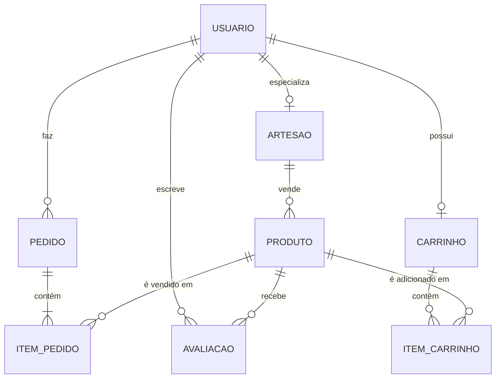
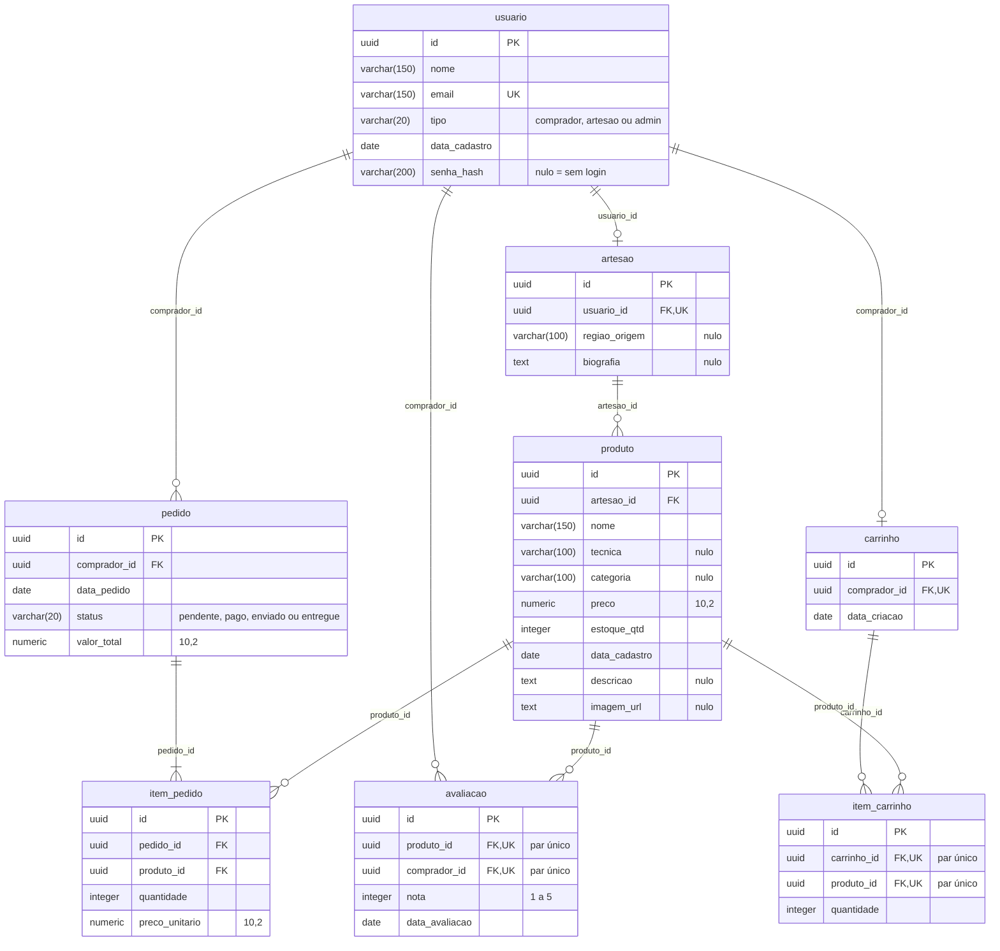

# DER e modelo lógico do schema `origem`

Diagramas do banco do marketplace Origem (front Raízes PE) no estado **final**: scripts `db/01`, `db/04`, `db/06` e `db/07` aplicados, incluindo `senha_hash` em `usuario`. Os diagramas batem com o schema do Neon e com o [dicionário de dados](dicionario-de-dados.md) (seção 5).

Os diagramas são Mermaid: o GitHub os desenha direto nesta página. Os arquivos-fonte e as imagens prontas para relatório e slides ficam em `docs/diagramas/`:

| Diagrama | Fonte | Imagem |
|---|---|---|
| DER (visão conceitual) | [`der.mmd`](diagramas/der.mmd) | [`der.png`](diagramas/der.png), [`der.svg`](diagramas/der.svg) |
| Modelo lógico (tabelas, tipos e chaves) | [`modelo-logico.mmd`](diagramas/modelo-logico.mmd) | [`modelo-logico.png`](diagramas/modelo-logico.png), [`modelo-logico.svg`](diagramas/modelo-logico.svg) |

Para regerar as imagens depois de mudar um `.mmd`: `npx -p @mermaid-js/mermaid-cli mmdc -i docs/diagramas/der.mmd -o docs/diagramas/der.svg`.

## 1. DER

Entidades e relacionamentos, na notação pé de galinha. O diagrama não mostra atributos; eles estão no modelo lógico (seção 2) e no dicionário de dados.

Como ler a cardinalidade (marcas do lado de cada entidade): `||` exatamente um, `o|` zero ou um, `o{` zero ou muitos, `|{` um ou muitos.

| Relacionamento | Cardinalidade | Regra |
|---|---|---|
| `usuario` especializa `artesao` | 1 : 0..1 | Um usuário do tipo `artesao` tem um perfil de artesão; os demais não têm (RN-02). Todo artesão pertence a um usuário |
| `artesao` vende `produto` | 1 : 0..N | Todo produto tem um artesão; um artesão pode ter vários produtos |
| `usuario` faz `pedido` | 1 : 0..N | Só usuário do tipo `comprador` faz pedido (RN-03) |
| `pedido` contém `item_pedido` | 1 : 1..N | Todo pedido tem ao menos um item (conferido no COMMIT) |
| `produto` é vendido em `item_pedido` | 1 : 0..N | O item guarda o preço do momento da compra (RN-05) |
| `usuario` escreve `avaliacao` | 1 : 0..N | Só comprador avalia (RN-03) |
| `produto` recebe `avaliacao` | 1 : 0..N | Um comprador avalia o mesmo produto uma única vez (RN-06) |
| `usuario` possui `carrinho` | 1 : 0..1 | Um carrinho por comprador |
| `carrinho` contém `item_carrinho` | 1 : 0..N | O mesmo produto aparece uma vez por carrinho |
| `produto` é adicionado em `item_carrinho` | 1 : 0..N | |

## 2. Modelo lógico

Tabelas, colunas, tipos e chaves, como estão no PostgreSQL. `PK` chave primária, `FK` chave estrangeira, `UK` chave única. Comentário "nulo" indica coluna que aceita nulo; as demais são `NOT NULL`. Colunas `numeric` têm precisão `(10,2)`. Nas tabelas `avaliacao` e `item_carrinho`, as duas colunas marcadas "par único" formam uma única restrição `UNIQUE` em conjunto.

O nome na linha de cada relacionamento é a coluna de chave estrangeira. Valores fixos: `usuario.tipo` (`comprador`, `artesao`, `admin`), `pedido.status` (`pendente`, `pago`, `enviado`, `entregue`) e `avaliacao.nota` (1 a 5), todos por `CHECK`.

A view `vw_popularidade_produto` (vendas e avaliações por produto) não aparece nos diagramas porque não é tabela. Ela está descrita no dicionário de dados.

## 3. O que mudou em relação ao modelo original (scripts 04 a 07)

O modelo físico original (script 01) tinha 8 tabelas e 39 colunas. Os scripts seguintes só **acrescentaram** colunas; nada foi removido.

| Script | Mudança | Onde aparece nos diagramas |
|---|---|---|
| `04_migracao_front.sql` | Acrescenta `produto.descricao` (`text`) e `produto.imagem_url` (`varchar(300)`), usados pelo front | `produto` no modelo lógico |
| `05_dados_raizes_pe.sql` | Só carga de dados (catálogo do front); **não altera a estrutura** | nenhuma |
| `06_imagem_produto.sql` | `produto.imagem_url` passa de `varchar(300)` para `text`, com limite de 2.800.000 caracteres (foto enviada pelo artesão, guardada como data URL) | `imagem_url` como `text` |
| `07_autenticacao.sql` | Acrescenta `usuario.senha_hash` (`varchar(200)`, aceita nulo): hash scrypt da senha; nulo significa sem login | `usuario` no modelo lógico |

Total final: 39 colunas originais + 3 acrescentadas (`produto.descricao`, `produto.imagem_url` e `usuario.senha_hash`) = 42 colunas. O script 06 só muda o tipo de uma coluna que já existia.

## 4. Como os diagramas se ligam ao banco

- Cada entidade do DER é uma tabela do modelo lógico, com o mesmo nome em minúsculas.
- Cada relacionamento 1:N do DER virou uma chave estrangeira na tabela do lado "muitos". A especialização `usuario`/`artesao` (1:0..1) virou FK com `UNIQUE` em `artesao.usuario_id`; o carrinho segue o mesmo padrão, com `UNIQUE` em `carrinho.comprador_id`.
- Não há tabelas associativas N:N: o vínculo entre pedido e produto é `item_pedido`, e entre carrinho e produto é `item_carrinho`, ambas entidades com atributos próprios (quantidade, preço).
- O que o diagrama não expressa mas o banco garante: os tipos de usuário em cada relação (triggers `trg_*_tipo_usuario`) e o total do pedido igual à soma dos itens (trigger `trg_pedido_confere`). Estão no dicionário de dados, seção 6.

## 5. Conferência

1. O modelo lógico foi comparado coluna a coluna com o catálogo de um PostgreSQL criado pelos scripts `01`, `04`, `06` e `07`: 8 tabelas, 42 colunas, tipos, nulidade, PK, FK e UK, sem divergência.
2. As cardinalidades do DER foram conferidas com as 10 chaves estrangeiras e as restrições `UNIQUE` do banco.
3. O dicionário de dados descreve as mesmas 8 tabelas e 42 colunas, e o schema do Neon foi conferido com 8 tabelas e 42 colunas (PI4-148).
